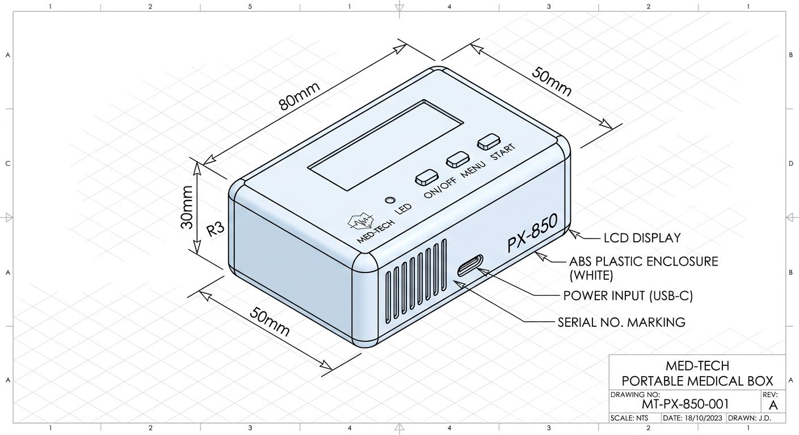
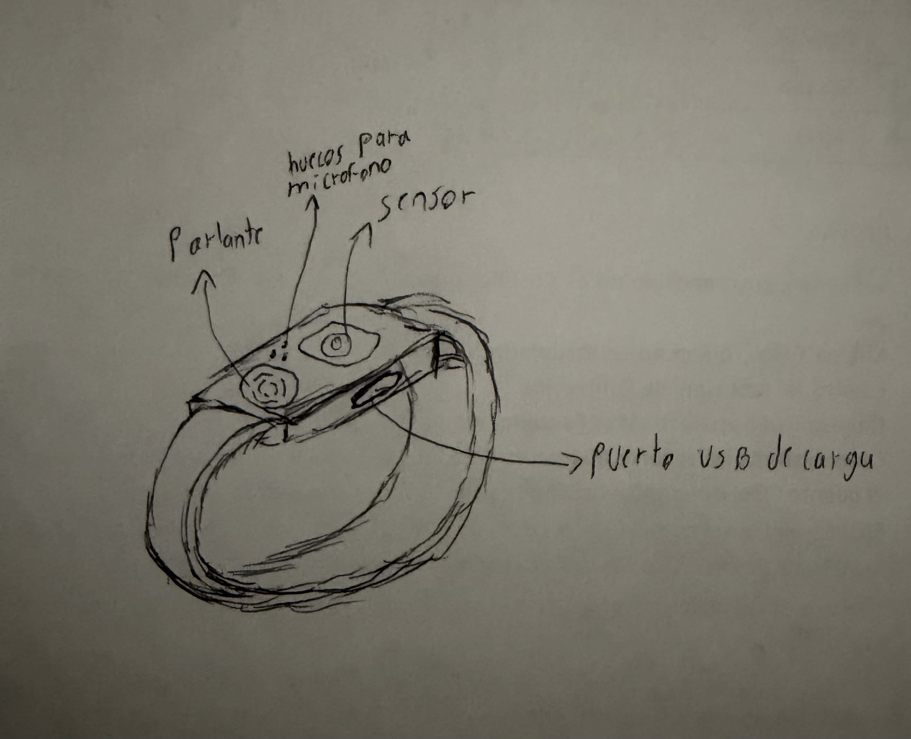
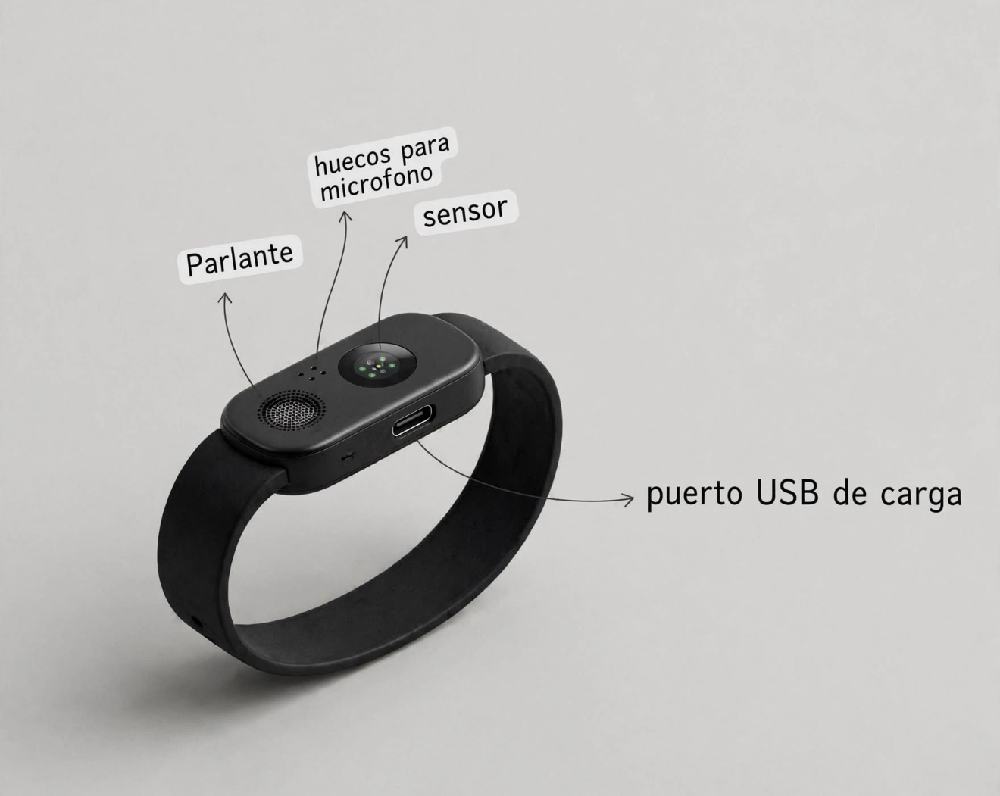
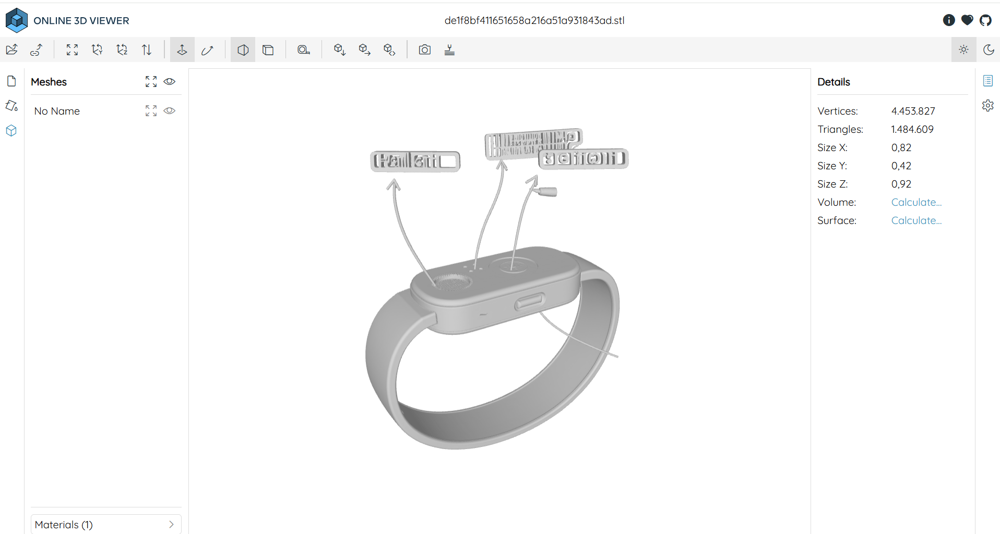
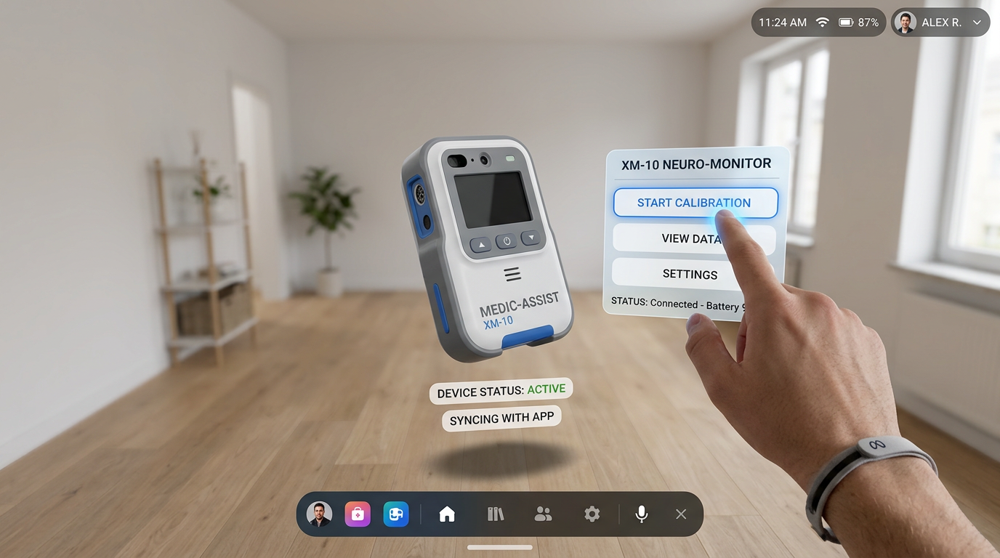

# Entrega V - Diseño CAD + Juego AR/VR
**Proyecto:** Dispositivo Asistente de Orientación y Monitoreo para Pacientes con Alzheimer  
**Estudiante:** Mateo Jiménez  
**Curso:** Diseño Electrónico  

---

## 1. Caja Generada en MakerCase (Dummie)
- **Dimensiones:** [Ej: 80mm x 50mm x 30mm]
- **Peso estimado:** [Ej: 150g]
- **Enlace / Archivo:** `caja_makercase.dxf` / `caja_makercase.svg` (subido en la carpeta del repo)
- **Imagen / Vista previa:**
  

---

## 2. Diseño a Mano del Proyecto
Boceto individual realizado a mano para la carcasa y distribución de componentes del dispositivo.
- **Imagen:**
  

---

## 3. Rediseño con Inteligencia Artificial (Meta AI / LMArena)
Rediseño conceptual generado a partir del boceto a mano mediante prompt de IA.
- **Prompt utilizado:** `"Genera una carcasa ergonómica, estética e industrial para un dispositivo médico portátil enfocado en pacientes con Alzheimer..."`
- **Imagen generada:**
  

---

## 4. Modelo 3D (Hyper3D / Hunyuan3D)
Modelado 3D del dispositivo listo para impresión o visualización.
- **Archivos 3D subidos:** `modelo_dispositivo.stl` / `modelo_dispositivo.gbl`
- **Visualizador online utilizado:** [3D Viewer Online](https://3dviewer.net)

---

## 5. Experiencia / Juego Interactivo AR/VR (Arena.ai)
Integración del modelo 3D en la plataforma Arena.ai para visualización interactiva en Realidad Aumentada / Realidad Mixta (Meta Quest).
- **Enlace de la experiencia en Arena.ai:** [(https://mateo1290.github.io/dispositivo-alzheimer-cad/s)]
- **Prompt utilizado en Arena.ai:** `"Crea un juego interactivo en 3D/WebXR usando Three.js que cargue el modelo 3D de la pulsera 'modelo_dispositivo.stl' (o la representación del dispositivo medico adjunto 'diseno_ia.jpg'). En el juego debe haber un personaje en un entorno 3D que pueda caminar (usando las flechas del teclado o controles de VR) llevando puesta la pulsera médica. El juego debe permitir al usuario interactuar con la pulsera (por ejemplo, presionar el botón de auxilio/sensor para que la pulsera emita luz o un mensaje de asistencia para Alzheimer). Haz que todo el código (HTML, JS, CSS) sea compatible para desplegarse directamente en GitHub Pages"`
- **Captura / Demostración:**
  
